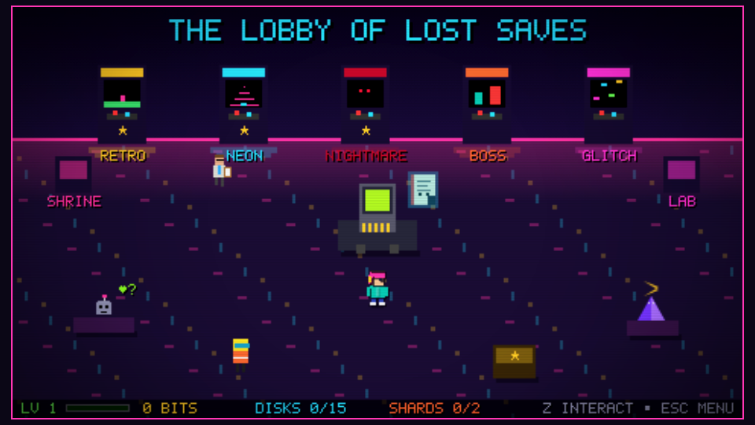
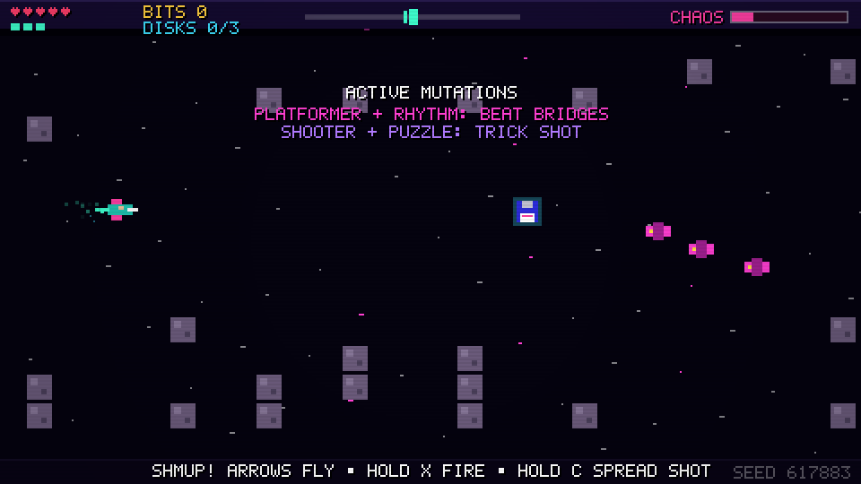
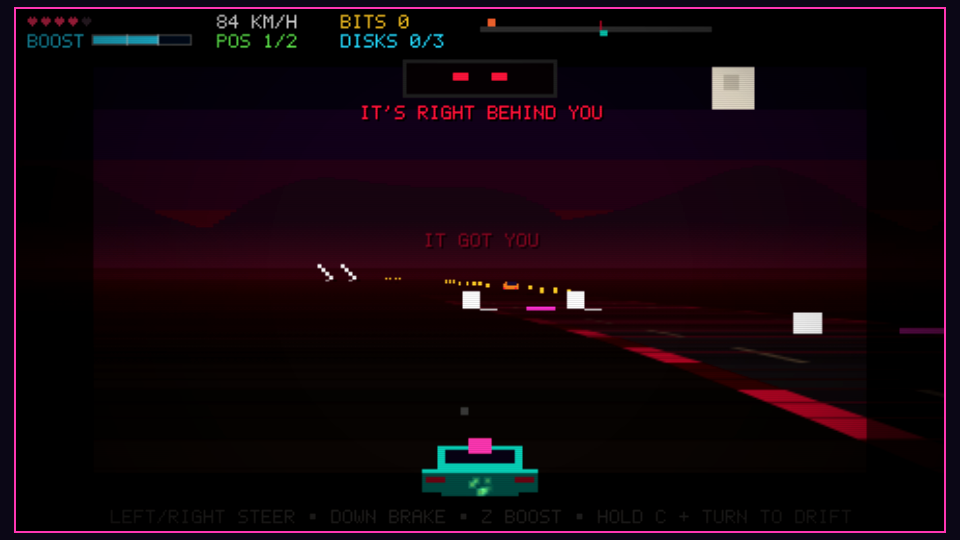
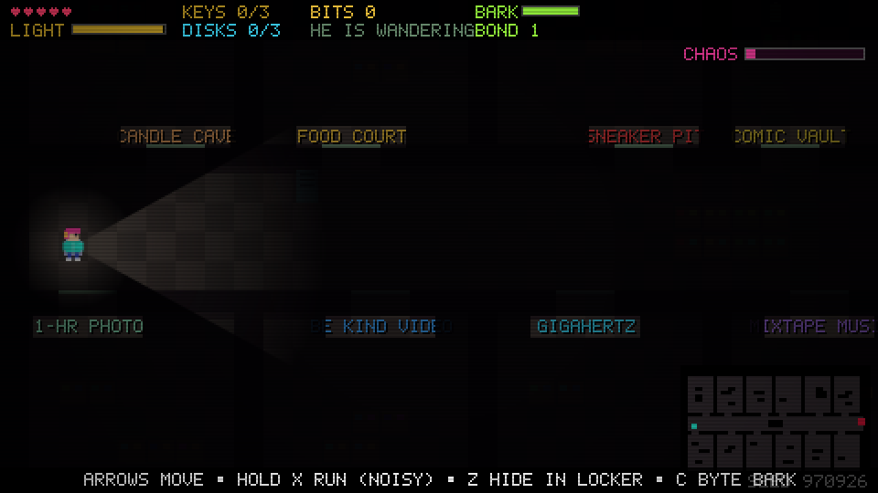
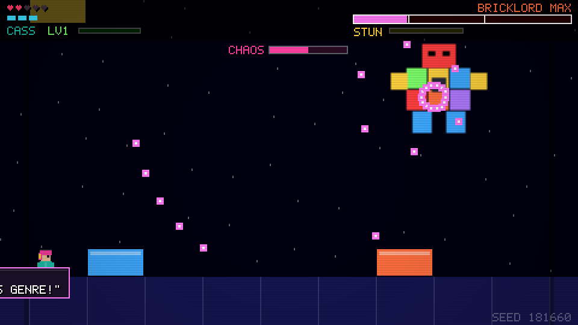
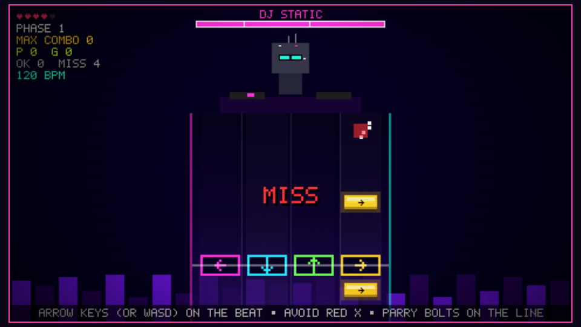
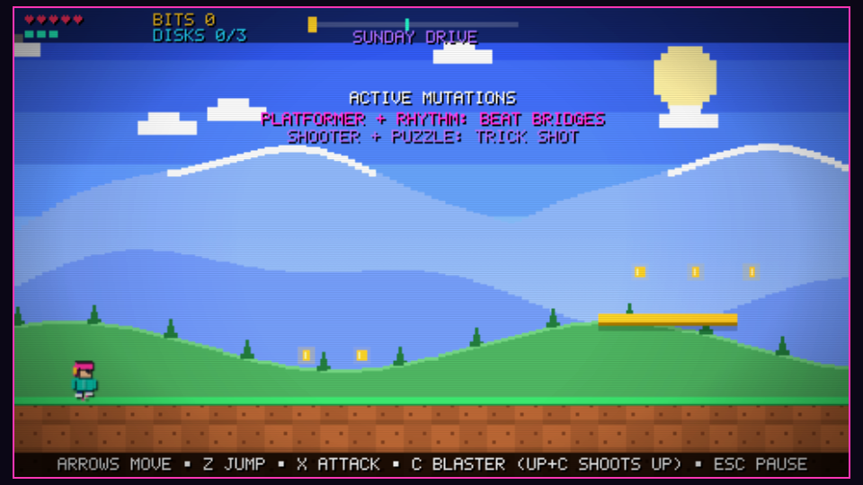

# CHAOS.exe: The 90s Gaming Multiverse

> The Cartridge Core kept every video game genre in its own cartridge. Then came **THE GREAT GENRE CRASH**. Now racing tracks run through haunted malls, rhythm notes are platforms, and the final boss just got bored of fighting games.

An original, open-source retro browser game where **every genre collides with every other genre** — and the collisions change how you play, not just how things look.



| | | |
|---|---|---|
|  |  |  |
|  |  |  |

## Play it

**No install:** build once and open `dist/index.html` in any modern desktop browser (it is a single self-contained file — no server needed).

```bash
npm install
npm run build        # -> dist/index.html
npm run dev          # live-rebuilding dev server at http://127.0.0.1:8000/dev.html
```

Requires Node 20+. A click or key press is needed before audio starts (browser autoplay rules).

## What's in the first release

**A hub and seven genuinely different worlds**, sharing one character, one level/XP curve, one bit economy, one save:

| World | Base genre | Mid-level genre shift | Genre-fusion mutations |
|---|---|---|---|
| **RETRO RAMPAGE** | Side-scrolling action platformer | Becomes a **horizontal shmup**, then lands back | **BEAT BRIDGES** (platformer + rhythm): platforms exist only on their half of the beat. **TRICK SHOT** (shooter + puzzle): blaster shots flip switches that open secret gates. |
| **NEON PANIC** | Pseudo-3D arcade racer vs. rival REX TURBO | At midnight it becomes **survival horror** | **NIGHT DRIVE** (racing + horror): THE LURKER hunts you, feeds on hesitation and crashes, and drops shadow barriers in your lane. **BASS BOOST** (racing + rhythm): boost on the beat for a PERFECT boost. **DRIFT ENCOUNTERS** (racing + RPG): long drifts trigger a turn-based skill check. |
| **NIGHTMARE MALL** | Top-down survival horror (keys, lockers, batteries) | Escalates with each keycard | **GOOD BOY PROTOCOL** (virtual pet + horror): BYTE, the pet you raise in the hub, follows you; its bond sets how long its bark stuns the stalker and lets it sniff out keycards. |
| **BOSS BEATDOWN** | 1-on-1 fighter vs. BRICKLORD MAX | At 25% HP the boss gets bored and turns the fight into a **bullet hell** | **GRINDCORE** (fighter + RPG): combo hits earn XP and level you up mid-fight. **LINE CLEAR KO** (puzzle + fighter): falling blocks stack; fill a row to crush the boss. |
| **GLITCH RHYTHM** | 4-lane rhythm boss fight vs. DJ STATIC | Phase 3 doubles down on tempo | **SHOTS ON THE ONE** (rhythm + bullet hell): on-time notes fire at the boss; misses send parryable static bolts down your lanes. |
| **CORE COMMAND** | Tower-defence strategy | From wave 5 spitters turn it into a **bullet-hell siege** | **VETERAN TOWERS** (strategy + RPG): towers earn XP from kills and level up on their own. |
| **PENALTY STORM** | Top-down football: dribble and shoot | The keeper answers with **bullet-hell patterns**; get hit and you lose the ball | **SLAP SHOT** (sports + bullet hell): the ball smashes every bullet it touches on the way to goal. |

Eleven fusions total (nine available from the start, two unlocked by play). Every mutation can be toggled in the hub's **Mutation Lab**; each active mutation adds +15% bits.

**THE CHAOS DIRECTOR** fires 22 telegraphed events across five categories — cosmetic, environmental, combat, genre transformation and legendary — with rules for cooldowns, minimum warning time, recovery after damage, genre compatibility, boss-specific events, accessibility, and unwinnable-combination prevention. Players can feed it with stylish play, summon it with chaos orbs, and bias it at the hub shrine. Watch for **KEVIN FROM QA**, who "fixes" a rule wherever he appears.

**ENDLESS RUN** (any cleared world): round after round on fresh seeds, a little tougher each time, with a heart patched up between rounds; bank your haul from the pause menu. **BYTE** grows through four forms (BYTE, KILOBYTE, MEGABYTE, GIGABYTE) as you care for it, earns small run perks, and can be dressed in hats, shades, scarves and wings.

**Also:** a lobby **Quest Board** (fifteen quests plus three **weekly goals** that reset every Monday, all paid out automatically), **lobby decor** to buy, an **assist mode** with an extra heart and slower enemies and a **Mini-Game Arcade** (CART CATCH, BYTE BREAKOUT, WHACK-A-GLITCH, STACK-A-CART and GLITCH MEMORY); two full bosses with phases, telegraphs, weak points and defeat sequences; a mercy-or-delete choice for each; an ending; 21 floppy disks; 27 achievements; boss rematches; seeded challenge modifiers on replays; a shop; a virtual pet to feed and train; a secret character; an original cast and central mystery.

## Controls

| Action | Default keys |
|---|---|
| Move | Arrow keys / WASD |
| Jump · Boost · Interact | Z / Space / J |
| Attack · Run (mall) | X / K |
| Special (blaster, drift, bark, Cart Wave) | C / L |
| Block (fighter) | Down |
| Pause | Esc / P |

Every key is remappable in **Settings → Remap Controls**. Each world shows its own controls when it starts. A simple on-screen pad appears on touchscreens (not yet tested on real devices — see limitations). Menus, the lobby and the three mini-games can also be played by tapping and dragging the screen itself; the worlds can be steered with gestures (drag to move, drag up to jump, tap to attack or boost, touch the lanes in Glitch Rhythm), and the pad works everywhere.

## Accessibility

Remappable controls · keyboard-only play · **game speed** 50–100% (rhythm songs slow down to match) · screen-shake slider · **reduced flashing** (caps flash intensity and removes flickery chaos events) · CRT toggle · Chaos Director intensity from OFF to HIGH · three difficulties · master/music/SFX volume and mute · large, telegraphed warnings for every boss attack and chaos event · the game is fully playable without sound.

## Seeds

Every run has a 6-digit seed (bottom-right of the screen and on the results card). Set **Settings → Fixed Seed** to replay or share an exact layout. `npm run seeds -- 1990 64` prints what any seed generates.

## Project layout

```
src/
  main.ts            boot, fixed-timestep loop, resize/focus/visibility handling
  game.ts            scene flow, dialogue, pause, toasts, post-effects
  core/              seeded RNG, remappable input, save/settings (+ migrations)
  render/            5x7 bitmap font, procedural pixel actors, particles, screen FX
  audio/             Web Audio synth SFX + procedurally composed music
  fusion/            GENRE FUSION registry (data) + engine (trait queries)
  chaos/             CHAOS DIRECTOR rules + event catalogue (data)
  procgen/           curated-chunk levels, race tracks, mall maps, rhythm charts (+ validators)
  modes/             the seven worlds, sharing ModeBase
  scenes/            title, settings, hub, results, ending, menus
  data/              story, cast, dialogue, shop, achievements, rewards
tests/               node:test unit tests (incl. headless physics vs. level validator)
scripts/             build, dev server, seed showcase, browser smoke/e2e/gallery
docs/                DESIGN.md (game design document), screenshots
```

Zero runtime dependencies and zero binary assets: every sprite is drawn from rectangles and every sound is synthesized at runtime.

## Quality checks

```bash
npm run check        # typecheck (src + tests) + 99 unit tests + production build
npm run smoke        # headless Chromium: plays every world, then drives the full campaign to the ending
```

The unit tests cover the RNG, saves and migrations, input remapping, every Chaos Director rule, the fusion registry (including a check that each mutation's traits are actually read by its mode), 300 seeds of level solvability, track/mall/chart validity, progression, glyph coverage, and a headless run of the real platformer physics to confirm the level validator's jump limits. The browser scripts need Python Playwright (`pip install playwright && playwright install chromium`).

## Known limitations

- **Toolchain:** the brief preferred Vite + Vitest. The environment this was built in had no npm registry access, so it uses **esbuild** (build + dev server) and Node's built-in **node:test** runner via **tsx** — all verified here. Because packages could not be installed, there is **no `package-lock.json`**; the first `npm install` creates one.
- **Browsers:** verified in headless Chromium. Firefox and Safari are untested; the canvas `saturation` / `difference` blend modes used by two cosmetic chaos events may look different there.
- **Mobile:** touch buttons exist but have not been tested on a real device, so mobile is not claimed as supported.
- **Audio:** the synth runs without errors in headless Chromium, but nobody has listened to the mix on real speakers yet; levels may need tuning.
- **Balance:** win paths, boss phases and judging are verified by automation (including a rhythm bot that scores PERFECTs); difficulty has not had broad human playtesting.

## Roadmap

Part 2 — **THE HIGH SCORE**: the remaining roadmap bosses (THE LURKER as a full encounter, THE CLOSING-TIME MANAGER, THE HIGH SCORE), plus expansion genres already designed in [docs/DESIGN.md](docs/DESIGN.md): kart racing + turn-based RPG battles, dating sim + horror, strategy + platformer, ~~sports + bullet hell~~ (built: PENALTY STORM).

## Contributing

See [CONTRIBUTING.md](CONTRIBUTING.md) — adding a mutation, chaos event or level chunk is a data change plus a few lines in a mode.

## License

MIT — see [LICENSE](LICENSE). All characters, art, music and writing are original to this project.
